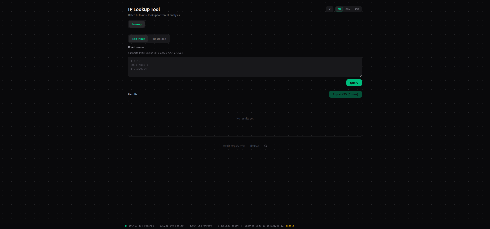
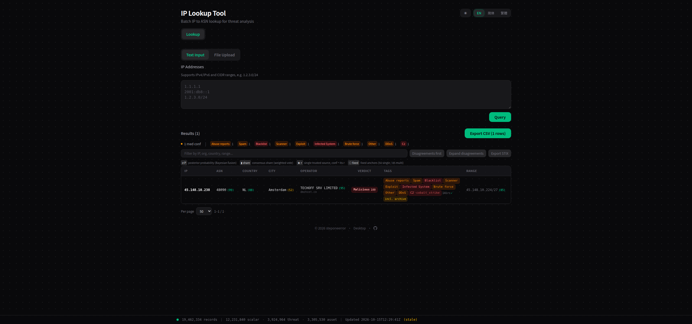
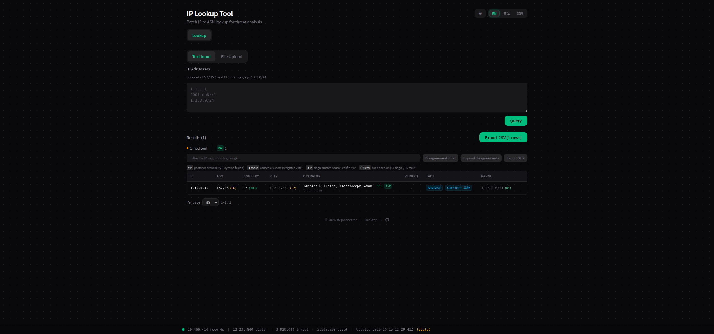
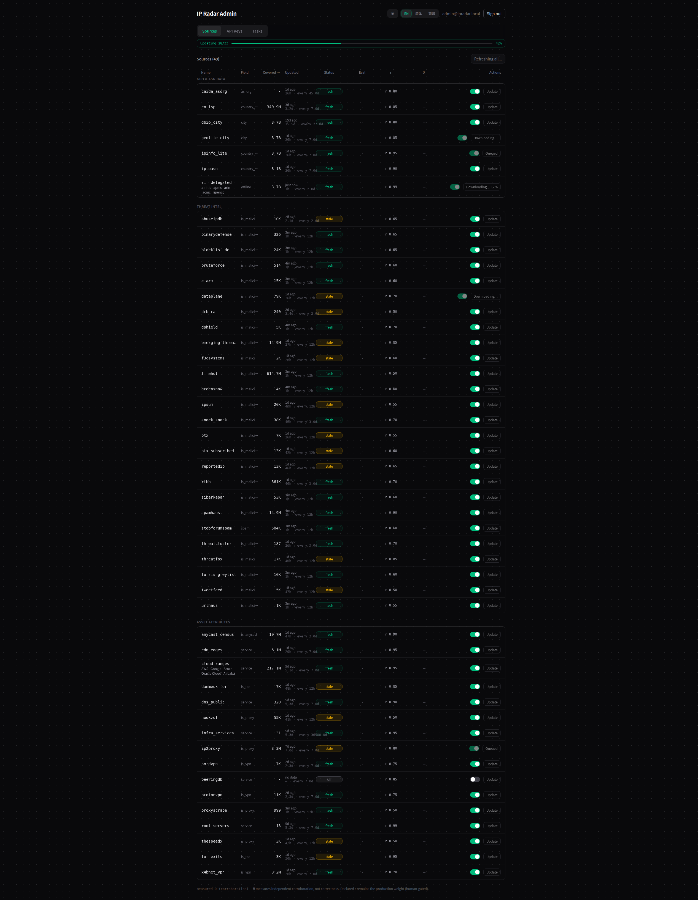
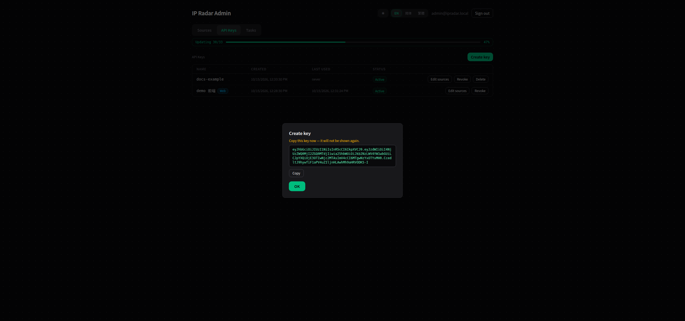
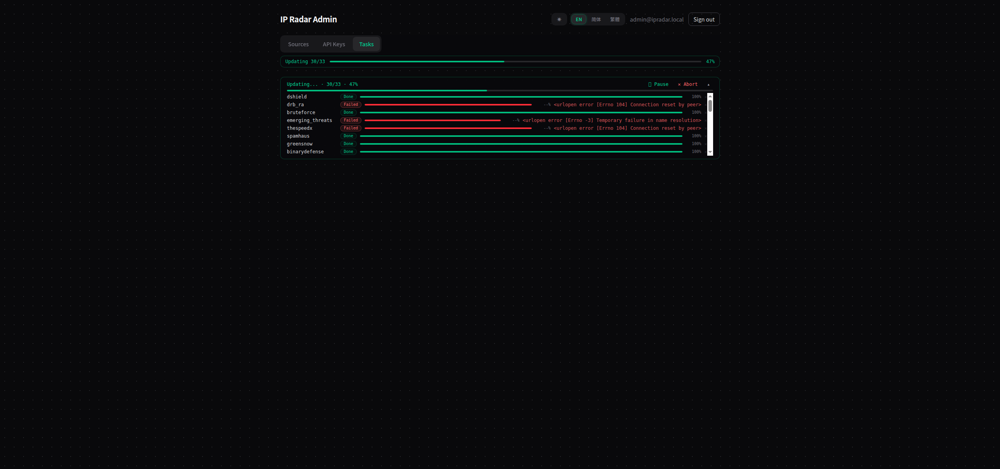

# IP Radar — 使用手册

[English](MANUAL.md) | **简体中文**

本手册面向已经(或即将)部署 IP Radar 的人:怎么查、怎么读懂返回结果、怎么用管理台、完整的 API 清单,以及日常运维。安装步骤、数据源目录与项目介绍见 [README](README.md)——本手册是它链接过来的深度参考。

以下示例均假设默认部署:单容器跑在 `http://127.0.0.1:8000`,数据落在 `ipradar-data` 卷。截图取自英文深色主题;界面另有简体中文、繁體中文与浅色主题(右上角切换)。

## 目录

- [1. 首次启动](#1-首次启动)
- [2. 查询](#2-查询)
- [3. 读懂结果](#3-读懂结果)
- [4. 导出](#4-导出)
- [5. 管理台](#5-管理台)
- [6. 源生命周期:加 → 评 → 调](#6-源生命周期加--评--调)
- [7. API 参考](#7-api-参考)
- [8. 故障排查](#8-故障排查)
- [9. 运维](#9-运维)
- [10. 周边生态](#10-周边生态)

## 1. 首次启动

`docker compose up -d --build` 之后,容器几秒内即可访问——但还没就绪。首次启动会把全部无 key 源(61 个源中的 56 个)下载并构建成数百万条记录。你会看到:

- **顶部进度横幅**实时跟踪无 key 源的下载/构建进度,构建完成后横幅消失。
- **查询在无 key 源构建完成前保持关闭。**在此之前,查询返回 `503` 与 `X-IPRadar-Reason: warming`——工具拒绝在半成品数据集上给判定。这是刻意的:绝不在残缺证据上出结论。
- **按 RAM 分档的安全窗口**(6 GB 以下 30 分钟、12 GB 以下 20 分钟、其余 15 分钟)保证构建卡死也不会把查询永久锁住——窗口过后,容器以现有覆盖度开闸。需要的话用 `IP_RADAR_COLD_START_TIMEOUT`(秒)覆盖。
- **后续启动几秒内从 `ipradar-data` 卷加载。**冷启动只发生一次。

首次构建需要时间与磁盘:数据卷预算 **≥ 6 GB**。内存方面,构建并发会迁就主机 RAM;小内存机器会磨一阵 swap 但能恢复。五个 key 源(AbuseIPDB、OTX ×2、IP2Proxy、IPinfo)在往 `.env.local` 填 key 之前保持熄灭——对照 README [Quick Start](README.md#quick-start) 的表格。

页面底部状态栏实时显示库的状态:

```
19,464,131 records | 12,231,840 scalar · 3,926,761 threat · 3,305,530 asset | Updated 2026-10-15T12:29:24Z (stale)
```

总记录数拆为 scalar(地理/ASN/网段事实)、threat(逐类型威胁证据)、asset(代理/VPN/Tor/服务身份属性)。`(stale)` 表示最新刷新槽还没在所有源上完成——错峰刷新期间的常态;见[管理台](#5-管理台)。

## 2. 查询



主页面就一屏:上面输入区,下面结果区。

**输入方式**(输入卡顶部的两个 tab):

- **文本输入**——每行一条。可以是裸 IPv4(`1.1.1.1`)、裸 IPv6(`2001:db8::1`)或 CIDR 网段(`1.2.3.0/24`)。网段在服务端展开;小网段逐行流回,大网段直接转为 CSV 下载(见下)。无效行会计数并报告,不静默丢弃。
- **文件上传**——格式同上,每行一个 IP/网段,以文件方式上传。

**深链**:`?ip=<地址>` 打开页面即自动查一次——README 里的示例链接用的就是它。常往文档里贴 IP 的话,给报告模板留一个书签。

**结果表**:每个展开的地址一行,列为 `IP · ASN · Country · City · Operator · Verdict · Tags · Range`。所有列头可排序。值旁边括号里的小数字是逐字段共识置信度——怎么读见下一章。表格上方的过滤框按 IP、组织、国家、网段收窄;分页每页 20/50/100/200。

**行容量**:表格最多渲染 **50,000** 个展开行。超过后界面切换模式,结果直接流成 CSV 下载而不再进表格——同一个查询,零 DOM 开销。(真正的天花板是 React 状态内存,约 5 万行 × ~2 KB。)

**分歧工具**(表格上方按钮):**Disagreements first** 重排,让源与源互相矛盾的行(国家不同、ASN 不同)浮到最前;**Expand disagreements** 恰好把这些字段的逐源证据就地展开。对「先粗筛再处理」的排查流程来说这是捷径:需要人看的行,就是机器吵翻的行。

**主题与语言**:☀/🌙 切换深浅主题,记忆跨访问(首帧前恢复——不闪错主题)。EN / 简体 / 繁體 切换界面语言。

## 3. 读懂结果

### 判定行

每次查询返回一个融合判定——`benign`(良性)、`suspicious`(可疑)或 `malicious`(恶意)——外加 0–100 置信度。融合是逐源证据上的 log-odds(贝叶斯)模型:每个源带一个手工设定的可靠性,威胁断言按 60 天半衰期衰减(昨天的目击比上季度的重;地理这类标量事实不衰减),独立佐证会叠乘。两条诚实的告诫内建在语义里:

- **0 意味着「无证据」,不是「清白」。**任何列表都没见过的地址得到 clean 判定,只是清白的弱证据——界面和 API 都这么对待(`threat.verdict: "benign", confidence: 0`)。
- **置信度是逐字段的,不只是逐判定的。**同一个 IP 可以是 `Country NL (88)` 同时 `City Amsterdam (52)`——表格展示每个字段各自的共识。



**Tags** 单元格装着命中的分类类型(`Abuse reports · Spam · Blacklist · Scanner · … · C2·cobalt_strike`)、命中的独立源数(`14src`)、证据是否含衰减归档(`incl. archive` = 部分目击已老到进入衰减,但仍然摆在桌上),以及源报出过的恶意软件家族。



干净 IP 的返回照样丰富:国家/城市/ASN 各带置信度、注册数据(注册局、注册国、分配日期)、中国网络的 ISP 归类(`is_isp`)、资产属性——anycast(`is_anycast`)、运营商、AS 域名(`as_domain`)。已知基础设施还会亮出服务身份:`8.8.8.8` 回来时标着 DNS · Google Public DNS。

### 逐字段共识

点击任意一行展开详情面板——每个字段的融合过程都在其中(API 暴露同样的结构;有裁剪):

```json
"country": {
  "value": "NL", "confidence": 88, "algorithm": "logodds",
  "sources": [
    {"source": "dbip_city",     "value": "AD", "reliability": 0.80},
    {"source": "geolite_city",  "value": "NL", "reliability": 0.85},
    {"source": "ipinfo_lite",   "value": "NL", "reliability": 0.95},
    {"source": "iptoasn",       "value": "GB", "reliability": 0.90}
  ],
  "alternatives": [
    {"value": "NL", "probability": 88.5},
    {"value": "GB", "probability": 7.4},
    {"value": "AD", "probability": 3.3}
  ]
}
```

融合算法共四种,每个融合值都带着徽标说明是哪种产出的:

| 徽标 | 算法 | 用于 | 含义 |
|---|---|---|---|
| σ P | `logodds` | 国家、ASN、逐类型威胁 | 把各源证据按可靠性换算后合并得到的最终概率 |
| ▮ share | `voting` | 城市(及多选项投票字段) | 跨源加权投票份额 |
| ★ r | `authority` | AS 组织、AS 名称 | 单一可信源,置信度 = 其可靠性 |
| ◇ fixed | `specificity` | IP 网段 | 固定规则——最具体的覆盖网段胜出 |

`sources[]` 拆解就是该字段的全部证据——谁说了什么、可靠性多少。`alternatives[]` 是落选候选及其概率——不用展开任何东西就能发现一个有争议的字段。

### 逐类型威胁证据

每个分类类型(IntelMQ 词表:`abuse-reports`、`spam`、`blacklist`、`scanner`、`brute-force`、`c2-server`、`ddos`、`exploit`、`infected-system`、`other`)带自己的融合判定和保真的逐源明细:

```json
"spam": {
  "verdict": "malicious", "detected": true, "confidence": 82,
  "algorithm": "logodds", "corroborated": true, "reporter_total": 9,
  "details": [
    {"source": "blocklist_de",  "verdict": "malicious", "native_categories": ["bots", "all"]},
    {"source": "reportedip",    "verdict": "malicious", "native_confidence": 87,
     "first_seen": "2026-10-13T01:04:28", "native_categories": ["Email Spam", "WP Fake SEO Bot"]},
    {"source": "stopforumspam", "verdict": "suspicious", "native_confidence": 62, "reporter_count": 9},
    {"source": "firehol",       "verdict": "informational", "tags": ["firehol_abusers_30d"]}
  ]
}
```

值得记住的字段:`corroborated`(不止一个独立源同意)、`reporter_total`(源统计人工举报数时的合计)、`verdict_conflict`(源在方向上真吵架——一个说恶意另一个说良性)、`malware_names`(家族,如 `win.cobalt_strike`)、`native_confidence` / `native_categories` / `tags` / `extra`(上游自己的标签原样保留——翻成共享词表的过程零损失)。

### 属性与短路

`attributes` 汇集资产信号:`is_proxy`、`is_vpn`(含 NordVPN/ProtonVPN 网段)、`is_tor`、`is_hosting`/云(AWS · Google · Azure · Oracle · 阿里——单一融合源,逐 feed 健康)、`is_cdn`(CloudFront/Cloudflare/Fastly 边缘)、`is_anycast`、`carrier`、`service`(DNS/NTP/根服务器身份)。私有与保留地址(`10/8`、`127/8`…)根本不进威胁源——直接短路并标记 `is_reserved: true`,某个黑名单画大圈画到 RFC1918 也不会让它「恶意」。

## 4. 导出

**CSV**——结果表上方的 `Export CSV` 按钮把当前结果全量导出,带完整证据深度:27 列,含融合判定 + 置信度、逐类型标签与恶意软件家族、聚合的 `reporter_total` / `corroborated` / `verdict_conflict`、跨源最早 `first_seen` / 最晚 `last_seen`、最高源可靠性,以及资产属性全集。可能被电子表格当公式执行的值会加前缀,恶意 feed 数据保持文本。展开超过 50,000 行时自动转为下载模式(表格模式关闭——见[查询](#2-查询))。

**STIX 2.1**——`GET /api/lookup/{ip}/stix` 返回该地址的 STIX 2.1 bundle:每个贡献源的 identity、indicator 与 observed-data,带着与 API 相同的逐源证据。镜像内置 `stix2` 库,开箱即用——对接原生讲 STIX 的 SIEM 很顺手。结果表上方的 **Export STIX** 按钮产出同一个 bundle。

## 5. 管理台

浏览器打开 `/admin`(与公开查询页分离的独立页面)。在 `docker-compose.yml` 的 `environment` 里设置 `IP_RADAR_ADMIN_EMAIL`(默认 `admin@ipradar.local`)与 `IP_RADAR_ADMIN_PASSWORD` 解锁——账号在下次启动时创建。登录有爆破守卫(每分钟 5 次)。

登录后是三个 tab(外加一枚悬浮任务进度胶囊,点击直达 Tasks tab):

### Sources(默认 tab)



全部源一张清单,按 **Geo & ASN data / Threat intel / Asset attributes** 分组,列有:

- **Field**——该源贡献什么(`is_malicious`、`city`、`is_tor`、`service`…)。
- **Covered IPs**——已加载快照覆盖的地址空间量。
- **Updated**——上次刷新的墙钟年龄,悬停显示内容年龄与刷新节奏(`26h · every 12h`——内容年龄是上游数据的内部时间戳,才是诚实的那个)。
- **Status**——`fresh` / `stale` / `off`。`stale` 表示刷新槽已到或逾期——多个源同时 stale 往往意味着调度器卡住或上游死了。
- **Eval / r / θ**——两种可靠性数字并排。**r** 是声明的、生产权威的权重(手工设定,只能经人工评审 PR 变更)。**θ** 是评估程序按各源互相印证的程度算出的可靠性参考值——只展示,绝不自动写进生产权重。某源 θ 长期低于其 r 就是在超额宣称;见[生命周期章](#6-源生命周期加--评--调)。
- **Actions**——开关启停源(停用的源保留数据,但不再刷新、不再贡献);**Update** 按钮立即强制单源刷新(按钮标签就是实时状态:`Queued`、`Downloading… 42%`、`Loading…`)。
- 顶部 **Refresh all** 把全部启用源排一次批量刷新——与 `POST /api/update-db` 同一件事。

### API Keys



程序化访问需要 key(同源网页不需要)。**Create key** 要求名字、可选的有效期(天)、作用域——*All sources* 开关,或对已有 key 用 **Edit sources** 做逐源白名单(比如只给某个脚本开放地理源)。令牌**只展示一次**——当场复制;之后列表只剩名字/创建时间/最近使用/状态,以及 **Revoke**(停用)/ **Delete** 操作。最近使用时间戳让休眠 key 一眼可见、便于清理。

Key 是用 `IP_RADAR_API_JWT_SECRET` 签名的 JWT;以 `Authorization: Bearer <key>` 发送。不同身份限流不同——见 [API 参考](#7-api-参考)。

### Tasks



所有下载/构建的任务流:每行一个源刷新,实时状态(`Queued → Downloading → Loading → Done/Failed`)、上游报告时的字节/百分比进度,以及最有用的部分——**明文失败原因**:`OTX_API_KEY not set — register at … and add the key to .env` 直接告诉你缺哪个旋钮;`urlopen error … Connection reset by peer` 是上游抖动,会按逐级加长的间隔重试。运行中的任务可逐个 **取消**(✕);批量任务顶部有 **Pause / Abort / Collapse** 控制。本 tab 经 SSE 实时更新——不用刷页。

### 更新横幅(公开页)

公开页顶部横幅带 **Check for updates** 按钮,发现新版本时给出可复制的升级命令。若启用 `docker-compose.yml` 里的自更新挂载(docker.sock + 仓库目录 + `IP_RADAR_UPDATE_TOKEN`),横幅变成 **Update now** 按钮——完整机制与注意事项见[运维](#9-运维)。

## 6. 源生命周期:加 → 评 → 调

自带的 61 个源不是天花板。整条闭环——扩充池子、测量一个源是否真有用、调整或退役——就是为自托管者设计的,每一步要紧的决策都留给人。

### 加(Add)

四条路径,按费力程度排:

1. **拨一个开关。**已禁用(或想静音)的源在[管理台 Sources tab](#5-管理台)是一个开关。零代码、零重启。
2. **点亮 key 源。**五个 key 源往 `.env.local` 填上 API key、重启即激活——key 名与注册链接表在 README [Quick Start](README.md#quick-start)。
3. **让 AI agent 接一个新源。**仓库自带三个 agent skill(`.pi/skills/`,由读项目级 skill 的 agent 加载,如 [pi](https://github.com/earendil-works/pi))。各一句话:*"Find me threat-intel sources worth adding"*(discover → 评分候选表)、*"Add GreyNoise"*(端到端接入一个指定源)、*"Check the health of all sources"*(管理/调优闭环)。
4. **手写源模块。**一个源就是 `backend/ipdb/_sources/` 里的一个 Python 文件，实现一个小约定——按固定模板(map-first)解析、原始证据原样保留存档、注册条目、测试。读一个小模块（如 [`backend/ipdb/_sources/bruteforce.py`](backend/ipdb/_sources/bruteforce.py) 加它的测试）就是全部入门；照着形状与守卫镜像即可。

### 评(Evaluate)

评估的两个消费面,数字同源:

- **管理台**在每个源旁展示实测 θ(90% CI)与其声明 r,`/api/eval*` 提供背后的报告卡(仅 admin;见 [API 参考](#7-api-参考))。
- **评估 CLI**,在克隆的 `backend/` 下运行:

```bash
python -m ipdb._eval --model          # 全体启用源(评估某一源时不含它自己)的相互印证对照模型 + 验收套件
python -m ipdb._eval --all            # 评估全部源
python -m ipdb._eval --audit          # 谱系审计:源与源之间谁抄了谁,以历次保存的模型文件为证据(只报告,仅供参考)
python -m ipdb._eval --anchors        # 已知答案回归检查;任一失败即 exit 1
python -m ipdb._eval --dsem           # DS-EM 公平对决:市场 vs 声明 r vs π̂(π̂ = 评估程序算出的真实比例估计;仅供参考)
python -m ipdb._eval --help           # 全部旗标(temporal、demand、readout…)
```

旗标背后的哲学:**测量建言,人裁终局。**θ 是按各源互相印证的程度算出的参考值——量的是印证,不是正确性。任何实测值都不会自动回流生产权重;采纳一个实测值必须走人工评审 PR 并引用评估报告。`--anchors` 回归检查是唯一硬失败模式——它钉住已知答案,防止重构让融合悄悄漂移。

### 调(Tune)

- **某源超额宣称**(θ 持续低于其 r):在引用评估报告的 PR 里下调声明 r,或在 Sources tab 先停用再想。
- **某源冗余或有害**(净影响评估说移除它能改善整体表现):停用,想清楚后删模块。
- **上游沉默了**:日落检测的故事——feed 冻结、内容年龄增长而墙钟刷新「成功」。准入检查(`--gate`/sentinel 机制,维护者级——见模块 help)的存在就是防止冻死的 feed 被意外重新收编;`Updated` 列的内容年龄数字是你的用户级信号。

### 退役(Retire)

停用保留数据(重新启用即刻生效);删除模块则在下次启动时把源从注册表移除。无论哪种,退役任何带权重的源后重跑一遍 `--anchors` 和 `--model`——全体源的相互印证结构变了,而这个检查跑起来很快。

## 7. API 参考

同源网页无需 key。程序化访问需要 API key([管理台 → API Keys](#5-管理台)),以 `Authorization: Bearer <key>` 发送。错误统一信封 `{"error": {"code": "...", "message": "..."}}`,带机器可读码(`unauthorized`、`bad_request`、`rate_limited`、`source_not_found`、`internal`…);限流响应附 `retry_after` 秒数。预热期间查询端点答 `503` 与头 `X-IPRadar-Reason: warming`。

交互式 schema 在 `/docs` / `/redoc` / `/openapi.json`,默认关闭——设 `IP_RADAR_ENABLE_DOCS=1`(重启)开启;公开部署保持关闭。

### 限流

| 身份 | 桶 | 限额 |
|---|---|---|
| 匿名(按 IP) | 批量查询(`query/stream`、`upload/stream`) | 6 / 分钟 |
| 匿名(按 IP) | 单查(`lookup/{ip}`、`…/stix`) | 30 / 分钟 |
| API key(按 key) | 全部查询端点,共享一桶 | 60 / 分钟 |
| 任何人(按 IP) | 管理台登录尝试 | 5 / 分钟 |

`IP_RADAR_RATELIMIT=0` 整体关闭(任何可达的部署都不建议)。

### 端点

| 方法与路径 | 作用 | 鉴权 |
|---|---|---|
| `GET /api/lookup/{ip}` | 单查——完整融合结果 | key |
| `GET /api/lookup/{ip}/stix` | 同上,STIX 2.1 bundle | key |
| `POST /api/query/stream` | 批量查询,NDJSON 流 | key |
| `POST /api/upload/stream` | 文件上传批量查询,NDJSON 流 | key |
| `GET /api/db-status` | 记录数、过期、预热标志 | key |
| `GET /api/sources` | 源目录 + 健康 | admin |
| `PATCH /api/sources/{name}` | 启停源(`{"enabled": false}`) | admin |
| `POST /api/sources/{name}/update` | 强制单源刷新 → `task_id` | admin |
| `POST /api/update-db` | 全部启用源排批量刷新 | admin |
| `POST /api/update-db/pause` / `resume` / `cancel` | 批量生命周期控制 | admin |
| `GET /api/tasks` | 任务快照(状态、进度、错误) | admin |
| `POST /api/tasks/{task_id}/cancel` | 取消单个任务 | admin |
| `GET /api/events` | 任务/批量事件的 SSE 流 | admin |
| `GET /api/eval` · `/api/eval/model` · `/api/eval/{source}` | 评估总览 / 整体模型 / 单源报告 | admin |
| `POST /api/eval/{source}/run` | 触发一次评估(202 Accepted) | admin |
| `POST /api/admin/keys` · `GET` · `PATCH /{sub}` · `DELETE /{sub}` | API key 增删改查 | admin |
| `POST /api/auth/jwt/login` / `logout` | 管理会话(HttpOnly cookie) | — |
| `GET/PATCH /api/users/me` | 管理员账号管理（fastapi-users） | admin |
| `GET /api/version` | 当前 vs 最新版本、更新标志 | key |
| `POST /api/update` · `GET /api/update/status` | 页内自更新(选配挂载) | admin + token |

### 示例

单查(响应有裁剪——完整形态见[读懂结果](#3-读懂结果)):

```bash
curl -s -H "Authorization: Bearer $KEY" http://127.0.0.1:8000/api/lookup/1.12.0.1
# → {"ip":"1.12.0.1","country":{"value":"CN","confidence":100,...},"city":{...},
#     "asn":{...},"as_name":{...},"threat":{"verdict":"benign","confidence":0,...},
#     "classifications":{...},"attributes":{...},"is_reserved":false}
```

批量流——NDJSON,一行一个 JSON 对象;`row` 事件按输入顺序带完整结果,`progress` 事件供你渲染实时计数:

```bash
curl -s -H "Authorization: Bearer $KEY" -H "Content-Type: application/json" \
     -d '{"ips":["1.12.0.1","45.148.10.238"]}' \
     -X POST http://127.0.0.1:8000/api/query/stream
# → {"type":"start","total":2}
#   {"type":"progress","done":0,"total":2}
#   {"type":"row","idx":0,"result":{...}}
#   {"type":"row","idx":1,"result":{...}}
#   {"type":"progress","done":2,"total":2}
#   {"type":"done","ok":2,"invalid":0}
```

管理会话——登录种下 HttpOnly cookie(204 无 body);保留 cookie jar:

```bash
curl -s -c jar.txt -X POST http://127.0.0.1:8000/api/auth/jwt/login \
     -H "Content-Type: application/x-www-form-urlencoded" \
     --data "username=admin@ipradar.local&password=<你的密码>"
curl -s -b jar.txt -X POST http://127.0.0.1:8000/api/sources/blocklist_de/update
# → {"task_id":"0d125a7b..."}
```

SSE 任务事件——首事件恒为全量快照(重连安全),此后每次生命周期变更一个事件:

```bash
curl -s -b jar.txt -N http://127.0.0.1:8000/api/events
# → data: {"type":"snapshot","data":{"tasks":[...],"batch":{...}}}
#   data: {"type":"task","source":"bruteforce","state":"downloading","pct":42,...}
```

## 8. 故障排查

**查询答 503 "database is warming up"**——首次构建期的常态;横幅在跟踪进度。若超过 RAM 分档窗口(15–30 分钟)仍如此,查 `docker logs` 看是否有源卡在重试循环,查磁盘——卷满了会拖死构建。`503 no-sources` 表示所有源都被禁了:去 Sources tab 重新启用。

**key 源一直失败**——Tasks tab 的失败文本会点名缺的环境变量(`OTX_API_KEY not set…`)。key 放进 `.env.local`(gitignored),然后 `docker compose up -d` 生效。

**某源连续几天 `stale`**——看该行的内容年龄 vs 刷新节奏。内容年龄增长而刷新「成功」= 上游冻结(见[退役](#6-源生命周期加--评--调))。墙钟年龄增长且带失败 = 看失败文本;瞬时网络错误按逐级加长的间隔重试(连续三次真失败触发告警——若已配置,见[运维](#9-运维))。

**磁盘渐满**——每次刷新先落新 epoch 目录再翻指针,大重建期间新旧两份并存。6 GB 是底线;全开大 geo 源的忙碌机器多给些。

**反代后面所有限流一起炸**——限流器看到的是反代 IP。设 `IP_RADAR_PROXY_HEADERS=1`(并把 `IP_RADAR_FORWARDED_ALLOW_IPS` 设为反代网段),让逐 IP 桶看到真实客户端。

**管理台 404 或像被锁**——开了 `IP_RADAR_PUBLIC_DEMO=1` 的实例对匿名访客隐藏写/内部面(含非例外通道 IP 的 `/admin` 登录);维护者例外通道是 `IP_RADAR_DEMO_ADMIN_IPS`——完整语义见 [`deploy/README.md`](deploy/README.md)。普通自托管则确认 admin 环境块已取消注释。

**更新横幅谎报有更新**——部署侧 tag 缓存问题:服务器上先 `git fetch --tags` 再构建,否则 `git describe` 回落旧基线(v1.4.2 现场记录)。

**Firefox/某客户端连吃 429**——你在以单 IP 撞匿名桶;换 API key(共享 60/分钟)或把批量摊开。

## 9. 运维

### 升级

```bash
git pull && docker compose up -d --build
```

`ipradar-data` 卷原地不动——升级无数据迁移。公开页横幅会告知新版本并给出命令("Check for updates" 刷新检查)。

**页内自更新(选配)**:取消 `docker-compose.yml` 里自更新挂载的注释(docker.sock + 仓库目录 + `IP_RADAR_UPDATE_TOKEN`),重启后横幅上出现 "Update now" 按钮。三个值得单列的注意点:

- 仓库目录挂载必须是**绝对宿主路径**(`/home/you/ip-radar:/app/repo`)——`./` 相对路径会破坏容器内的 compose 回放。
- 挂 docker.sock 等于给容器宿主级 root 控制权——该模式适合局域网自托管,不适合公开机器。
- 容器内 git pull 写的文件属主是 root(宿主侧操作可能需要 `sudo` / `git safe.directory`);而且改了被跟踪的文件(如 `.env`)后 `git pull --ff-only` 会按设计拒绝更新——本地覆盖放 `.env.local`。

### 备份与恢复

全部状态在一个命名卷里(`ipradar-data` → `/app/data`):逐源原始下载、LMDB epoch 目录(每次重建生成的新版本目录)及其 `.ptr/.count/.cov/.disjoint` 伴随文件、SQLite 双件 `auth.db`/`alerts.db`。重建从不原地写——新 epoch 落地,指针原子翻转。

**停机拷贝(最简,恒一致):**

```bash
docker compose stop ipradar
docker run --rm -v ipradar-data:/data -v "$PWD:/backup" alpine \
     tar czf /backup/ipradar-data-$(date +%F).tgz -C /data .
docker compose start ipradar      # 永远不要 `down -v` ——那会删卷
```

**热拷贝(按源,停不了机时):**先拷 epoch 目录、最后拷伴随文件,再确认 `.ptr` 没在拷贝中翻转(翻了就重拷该源)。SQLite 双件用 `sqlite3 <db> ".backup /target"`——写入中途的 `-journal` 伴文件会让裸拷贝撕裂。

**恢复:**把卷拷回去,`docker compose up -d`,然后核对启动行 `Loaded <count> <source> + …` 与备份前的 `/api/db-status` 一致。

真正不可再生的只有 `auth.db`/`alerts.db`(key、告警历史);若你保有 `_calibrated.json` 校准覆盖,它同属此列(手工声明的可靠性永不自动再生)。其余数据文件都能从公共 feed 重新下载——最坏情况,丢卷的代价是一次冷启动,而不是你的配置。

### 源告警(选配,默认静默)

调度器跟踪每个源的存活,但除非你接了通知槽,否则一言不发。把 `IP_RADAR_ALERT_URLS`(`environment` 块或 `.env.local`)设为逗号分隔的 [apprise](https://github.com/caronc/apprise) 风格 URL——`mailto:you@example.com`、Discord/Telegram/飞书 webhook——当某源停止更新、持续下载失败或库加载失败(如 epoch 损坏)时,你会收到一条合并消息。重启生效。无论是否配置,逐源健康恒可在 `/api/sources` 看到。

### 维护者注记

发版两个坑:release commit 必须含至少一个非 markdown 文件变更(CI 的 `paths-ignore` 跳过纯 `**.md` 推送,纯 md 的发版 commit 不会触发 tag↔CHANGELOG↔GitHub Release 一致性检查闸);部署服务器上构建前先 `git fetch --tags`,否则版本端点回落旧基线、横幅谎报更新。

## 10. 周边生态

- **[IP Radar Desktop](https://github.com/steponeerror/ip-radar-desktop)**——常驻托盘的伴侣应用:一个全局热键查询剪贴板里的任何 IP,逐源判定并排看,整张列表一发入魂。Linux/macOS/Windows 安装包在其 Releases 页。
- **集成**——各带自己的 README:[fail2ban](scripts/fail2ban/README.md)(先过本地判定再封禁;CDN 边缘跳过、确认恶意长封)、[Graylog](integrations/graylog/README.md)(查表把源 IP 变成国家/ASN/融合判定,零插件)、[Wazuh](integrations/wazuh/README.md)(把每条含 IP 告警富化成 ECS `threat.indicator` 后续告警)。
- **AI skills**——三个源生命周期 skill 在 `.pi/skills/`(`discover-intel-sources`、`add-intel-source`、`manage-intel-source`);见[生命周期章](#6-源生命周期加--评--调)与 README 表格。
- **评估报告卡**——每个源的 θ 历史与报告卡都在管理台里看（`/api/eval*`），无需另存文件。
- **在线演示**——[ipradar.huxiao0207.dpdns.org](https://ipradar.huxiao0207.dpdns.org)，只读模式（查询完全可用）。
